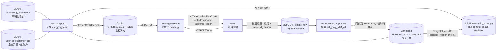

# 话务管控 - 总览与端到端链路

## 1. 是什么

话务管控是“专线质检”（vi）的一个子系统：按企业配置的**管控策略**，对报备号码（700 号码 / 专线主叫）的外呼行为做准实时判定，命中后在下一次呼叫时**拦截、放音后挂断、告警（仅记录）或放通**，并在话单上打 `append_reason` 原因码，日终汇总成管控统计。需求编号见《话务管控策略运行逻辑（测试关注）》：“20260601-话务管控模块需求”（原文未随附）。

相关文档：

| 文档 | 内容 |
| --- | --- |
| `01-mid-number/traffic-control/strategies.yaml` | 每条策略 / 每个脚本的结构化描述（配置表、判定条件、Redis key、原因码、状态、问题） |
| `01-mid-number/traffic-control/codes.md` | append_reason、opType / control_command / control_action、放音码对照表与 CONFLICT |
| `01-mid-number/traffic-control/testing-guide.md` | 测试关注点与每条策略的正例 / 反例 / 边界用例 |
| `01-mid-number/traffic-control/go-live.md` | 上线依赖、步骤、crontab、回滚与清理 |

职责划分（关键事实）：

| 组件 | 做什么 | 不做什么 |
| --- | --- | --- |
| vi-cront-jobs | 定时读策略表 + 话单，命中后**写 Redis 管控标记**，写管控明细 / 日统计 | 不执行拦截，不提供接口，不用 MQ |
| strategy-service（`com.cmic.vi.strategy`，Go 服务，不在资产中） | 呼叫时被 vi-as 调用，读 Redis 管控 key（推断），对 offtime/threshold 做实时计数（推断），返回 opType / 放音码 / appendReason | — （实现待确认） |
| vi-as | 呼叫建立前同步查询 strategy-service，按 opType 选择控制器，把 appendReason 写进话单 | 不读 Redis 管控 key |

## 2. 端到端链路



| # | 环节 | 做什么 | 代码 / 文档位置 |
| --- | --- | --- | --- |
| 1 | 策略配置 | 运营在 `vi_strategy.strategy_*` 配置策略（status=1 生效，effect_time 生效时间）；写入方未知（推测 ops-platform，待确认） | 《话务管控策略表DDL》；`vi-assets/vi-cront-jobs-master/viStrategy*.py` 中的 SELECT |
| 2 | 企业过滤 | 号码级判定脚本只处理 `customer_tab.status=1 AND is_call=1` 的企业；配置同步脚本只要 `status=1` | `vi-assets/vi-cront-jobs-master/apps/general.py:get_call_enabled_customer_ids`、`get_status_enabled_customer_ids` |
| 3 | 主账户展开 | 老 6 策略有 `is_main/app_id`：独立策略优先，主账户策略展开到无独立策略的子企业 | `vi-assets/vi-cront-jobs-master/apps/general.py:resolve_strategies_with_main` |
| 4 | 定时判定 | 每分钟（Offwork 每 10 分钟）查当天话单，按主叫统计，命中阈值 | 各 `viStrategy*.py:main`，见 `strategies.yaml` |
| 5 | 写 Redis | key 不存在或策略今天更新过时 `SET {前缀}{主叫或企业}` JSON，`control_valid_second>0` 时 `EXPIRE` | 各脚本 main；`apps/general.py:is_strategy_updated_today` |
| 6 | 写明细 | 仅 key 原本不存在（首次触发）时 INSERT `mid_bussops.call_control_detail` | `vi-assets/vi-cront-jobs-master/apps/clickhouse.py:ckAddObjects` |
| 7 | 停用清理 | 策略 status=0 时扫描对应前缀并 DEL | `vi-assets/vi-cront-jobs-master/viStrategyDisabledRedisClear.py:main` |
| 8 | 呼叫时查询 | vi-as 在 `startMode==0` 时 POST `{strategyHost}/strategy`；strategyHost 由 ETCD 服务名 `com.cmic.vi.strategy` 发现；ETCD `/config/audit_strategy_allow=0` 或无节点时跳过 | `vi-assets/vi-as-master/src/main/java/com/cmic/business/BusinessEvent.java:BusinessEvent.doStrategyQuery`、`config/ConstantConf.java` |
| 9 | 执行管控 | `opType=="0"` → `onDisconnect`，finish_state=22（STRATEGY_HIJACKING），走 `ErrorController` 放音后挂断；其他 opType 放行，可改主/被叫放音码 | `vi-assets/vi-as-master/src/main/java/com/cmic/util/SessionLimitUtil.java:SessionLimitUtil.auditLimitIntercept`、`bizcontroller/ControllerAgent.java:ControllerAgent.start` |
| 10 | 话单 append_reason | 有 appendReason 就写入（告警 / 放通也会写）；opType=0 且无 appendReason → 5；opType=1 且无 appendReason 但改了放音等 → 8 | `ControllerAgent.start`（`billNew.setAppendReason`）、`AuditResponseEntity.passButChangeResponse` |
| 11 | 移表 | 话单在 `bill_new` 中，呼叫结束 / 推送后由 vi-billcenter、vi-pusher 移到 `bill_yyyy_MM_dd`；StarRocks 同名库的同步方式待确认 | vi-billcenter `BillCommonFun.createHistory` |
| 12 | 明细补录 | Offwork / BusinessThreshold 不写明细，由 BillDetail 每小时按上一小时话单 `append_reason IN (13,20)` 补录 | `vi-assets/vi-cront-jobs-master/viStrategyBillDetail.py:main` |
| 13 | 日统计 | 每天 01:00 按昨日话单 `append_reason` 分组写 `call_control_statistics` | `vi-assets/vi-cront-jobs-master/viStrategyDailyStatistics.py:main` |

vi-as 请求 strategy-service 的报文（`BusinessEvent.initAuditSendJson`）：`billId、callerNo、calleeNo、bizNo、companyId、customerId、callerProvinceId、calleeProvinceId、callerCityId、calleeCityId、handleStartTime`；响应读取 `opType、callNoPlayCode、calledPlayCode、appendReason`。HTTP 超时 500ms（`AuditStrategyQuery.query`）；HTTP 非 200、异常、超时都**放行**（只打日志）。

> `AuditStrategyCallBack`（另一套请求报文：userId/appId/secretNo/displayNo…）在 vi-as 中没有任何实例化，是死代码，不要据此理解协议。

Redis value 通用结构（String / JSON，`vi-cront-jobs` 写入）：

```json
{"isMain": 0, "priority": 0,
 "condition": {"customerId": "<四级企业ID>", "threshold": "<仅 offtime/threshold>", "curfew": "<仅 offtime>"},
 "action": {"opType": "<策略表 control_command 原值>", "appendReason": "<硬编码原因码>"}}
```

`isMain` 只有老 6 策略写；示例 key：`highfreq-700xxxx0001`。key 与原因码全表见 `codes.md`。

## 3. 代码位置速查

| 路径（`vi-assets/vi-cront-jobs-master/` 下） | 职责 |
| --- | --- |
| `viStrategy*.py`（16 个） | 每个一个 cron 进程，逻辑在 `__main__` |
| `apps/general.py` | 企业过滤、主账户展开、`is_strategy_updated_today`、邮件 `get_mail`、`uniops_monitor` |
| `apps/database.py` | MySQL 引擎（SQLAlchemy binds：vi_strategy、vi_bill、user_qc、mid_bussops 等） |
| `apps/clickhouse.py` | `ckSelectForSQL`（vi_bill 引擎为 StarRocks）、`ckAddObjects`（clickhouse_driver 写 CK） |
| `config.py` | 选配置目录、Jinja2 渲染 `config.yaml`、加载 `logging.yaml` |
| `ck_check.py`、`dataCheck.py`、`dailyRange.py` | 手工 / 调试脚本，不在 crontab |
| `apps/models.py`、`apps/aes.py`、`apps/sftp.py`、`apps/timeUtil.py` | 未被策略脚本引用（`timeUtil` 是否使用待确认） |

## 4. 部署与 cron

- 无 Dockerfile、无常驻进程、无端口；以 crontab 方式部署（README 与《话务管控上线依赖》）。
- 依赖 `requirements.txt`（UTF-16 编码）；上线依赖要求 Python 3.11+ 与独立 venv。
- 频率：判定 / 同步 / 清理脚本每分钟；Offwork `*/10`；BillDetail 每小时第 5 分；ActivePhone、DailyStatistics 每天 01:00。完整表见 `go-live.md`。
- crontab 无 `flock` 互斥，单次超过 1 分钟会与下一次重叠。

## 5. 环境配置

| 项 | 说明 | 位置 |
| --- | --- | --- |
| `CRONT_ENV` | 缺省 / `production` → `config/`；`south` → `config.south/`；`north` → `config.north/`；`test` → `config.test/`；其他 → `config.local/` | `config.py` |
| `config.yaml` | **不在仓库中**，需部署时提供；内容中的 `{{变量}}` 由环境变量经 Jinja2 渲染（变量名待确认） | `config.py` |
| `logging.yaml` | 仓库内 `config/`、`config.test/`、`config.local/` 各一份；`config.south/`、`config.north/` 目录不存在 | `config/logging.yaml` |
| 配置项（只列名） | `SQLALCHEMY_DATABASE_URI`、`SQLALCHEMY_BINDS`、`CK_DATABASE_URI`、`CK_BINDS`、`CLICKHOUSE_BUSSOPS` 等、`VI_STRATEGY_REDIS`（HOST/PORT/PASSWORD/DB）、`UNIOPS_MONITOR`、`LOGGING_PATH` | `apps/*.py` |
| 日志 | `/var/log/vi-cront-jobs/{info,errors,info-vi-strategy}.log`，logger `vi_strategy` | `config/logging.yaml` |
| 脚本内开关 | `USE_MYSQL`（只有 LongCall 为 True）、`SCRIPT_TAG`（未使用） | 各脚本顶部 |
| vi-as 侧开关 | ETCD `/config/audit_strategy_allow`（0 关闭策略查询）；服务名 `com.cmic.vi.strategy` | `vi-assets/vi-as-master/src/main/java/com/cmic/util/DevHelp.java` |

## 6. 已知问题

| # | 问题 | 影响 | 证据 |
| --- | --- | --- | --- |
| 1 | `apps.email` 模块缺失，ActivePhone、DailyStatistics 顶部 import 即失败 | 日统计不产出；`active_phone_tab` 不更新 → 两条“沉默号码”策略失真 | `viStrategyActivePhone.py`、`viStrategyDailyStatistics.py` 第 8/9 行 |
| 2 | README crontab 写 `CRONT_ENV=test`，路径却是生产目录 | 照抄到生产会加载 `config.test/` | `README.md` vs `config.py` |
| 3 | LongCall `USE_MYSQL=True`（注释称 True 为“MySQL 测试”） | 生产走 MySQL 查话单；且不过滤时长，全量拉到 Python | `viStrategyLongCall.py` |
| 4 | 号码型 key 不含企业 ID | 多企业共用号码时互相覆盖；清理按最后写入者判定 | 各脚本 `redis_key` |
| 5 | “策略今天更新过”时每次运行都覆盖并重置 TTL | 当天命中号码被持续管控，超过 control_valid_second | `apps/general.py:is_strategy_updated_today` |
| 6 | BusinessRange 三维度共用 `bizrange-` key，且硬编码 `HAVING COUNT(*) > 50` | 原因码后写覆盖；50 通以下不判定 | `viStrategyBusinessRange.py` |
| 7 | appendReason 硬编码，策略表 `append_reason` 列不生效 | 改原因码需改代码；与策略表编码不一致 | 见 `codes.md` |
| 8 | `effect_time` / `control_valid_second` 为 NULL 时 TypeError | 当次整批策略不同步 | Offwork、BusinessThreshold、各脚本 `int(...)` |
| 9 | 明细写失败不回滚 Redis；明细 id = 毫秒时间戳 + 4 位序号，多脚本并发可能冲突 | 统计缺失 / 主键重复 | `gen_snowflake_id` |
| 10 | DailyStatistics 防重被注释 | 重跑重复写统计 | `viStrategyDailyStatistics.py` |
| 11 | 判定只读 `bill_YYYY_MM_DD`，话单需先从 `bill_new` 移表并同步到 StarRocks | 判定延迟 = cron 间隔 + 移表 / 同步延迟；进行中呼叫不计入 | vi-billcenter `createHistory`；同步机制待确认 |
| 12 | strategy-service 不在资产中 | Redis key 的读取方式、offtime/threshold 实时计数、threshold 的统计周期来源均无法核实 | `vi-as` `ConstantConf.GO_STRATEGY_SERVICE_NAME` |
| 13 | strategy-service 超时 / 失败一律放行 | 策略服务故障时管控静默失效 | `BusinessEvent.doStrategyQuery` |
| 14 | opType=0 时主叫放音码被 `callNoPlayCode` 覆盖，即使为空串 | 返回空放音码时放音行为待确认 | `SessionLimitUtil.auditLimitIntercept` |
| 15 | 6 张新策略表（difarea_high_frequency 等）没有 DDL，也不在《话务管控上线依赖》中 | 新环境建表无依据 | 见 `strategies.yaml` status=undocumented |
| 16 | `dataCheck.py` 硬编码真实格式号码 | 违反红线，建议删除或脱敏 | `dataCheck.py` |

CONFLICT: `vi-assets/vi-cront-jobs-master/README.md`（`CRONT_ENV=test` + 生产路径） vs `vi-assets/vi-cront-jobs-master/config.py`：生产缺省应为 `production`。
CONFLICT: 《话务管控策略运行逻辑（测试关注）》（“目前有 6 个策略”） vs `vi-assets/vi-cront-jobs-master/`：代码已有 12 个判定 / 同步策略脚本（13 个策略编号）及 4 个辅助脚本。
CONFLICT: 《话务管控策略运行逻辑（测试关注）》SQL（`to_date(...)`、`to_start_of_hour(...)`、ClickHouse 语法） vs `vi-assets/vi-cront-jobs-master/viStrategyHighFrequency.py`：代码用 `CURDATE()`、`DATE_FORMAT(NOW(), '%Y-%m-%d %H:00:00')`，查询 StarRocks。
CONFLICT: 《话务管控策略表DDL》（6 张表无 `is_main`、`app_id` 列） vs `vi-assets/vi-cront-jobs-master/apps/general.py:resolve_strategies_with_main`：老 6 策略脚本 SELECT 并依赖这两列。

## 7. 待确认

1. strategy-service 的仓库、Redis 读取逻辑、offtime/threshold 如何计数、`threshold-` value 中没有 stat_cycle_second 时统计周期从哪来。
2. 生产 crontab 的 `CRONT_ENV`；`apps/email.py` 线上是否单独部署。
3. StarRocks `vi_bill.bill_YYYY_MM_DD` 由谁、以何频率从 MySQL 同步；`mid_bussops` 是否 ClickHouse（写入用 clickhouse_driver，推断是）。
4. qa-server 的 `STRATEGY_CONFIG_URL`（中高风险质检结果推送）是否就是 strategy-service；二期话单 `control_action` 的写入方。
5. 策略配置表的写入方（ops-platform？）。
