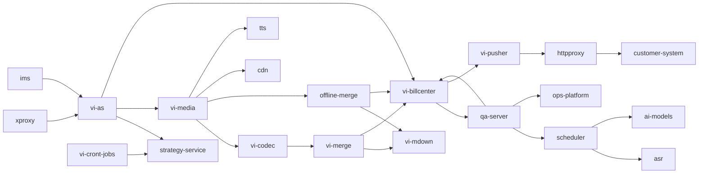

# 总体架构

专线质检复用 700 大网把呼叫送进 vi-as，媒体链录音或分片，话单中心在合音结果到达后向 qa-server 建任务，scheduler 编排模型，vi-pusher 把结果推给客户。话务管控在接通前单独查询，不读取质检结果。

真实依赖以 `05-code/dependency-map.yaml` 为准。下图只使用已登记的服务名和外部系统名。

## 分层

| 层 | 组件 | 说明 |
| --- | --- | --- |
| 接入 | xproxy、ims、vi-as | SIP B2BUA，UDP 5080 |
| 媒体 | vi-media、vi-codec、vi-merge、offline-merge、vi-mdown、cdn、tts | 锚定、推流、合音、放音 |
| 话单与推送 | vi-billcenter、vi-pusher、httpproxy | 建质检任务、推客户 |
| 质检 | qa-server、scheduler、asr、ai-models | HTTP 建任务，RabbitMQ 编排 |
| 管控 | vi-cront-jobs、strategy-service | 接通前拦截/放音/告警 |
| 运营 | ops-platform | 报备、企业、门户；源码不在本次资产 |

## 两期

| 期 | 决策 | 图 |
| --- | --- | --- |
| 一期准实时 | `09-decisions/ADR-003-near-realtime-qc.md` |  |
| 二期实时分片 | `09-decisions/ADR-004-realtime-segment-qc.md` |  |

模块交互原图：

设计文档整理见 `00-context/design-docs/digest.md`。图中的 vi-bill 即本库的 vi-billcenter；dcc-media / dcc-merge 是一期图上的旧名，对应源码仓库是 vi-media、offline-merge。
